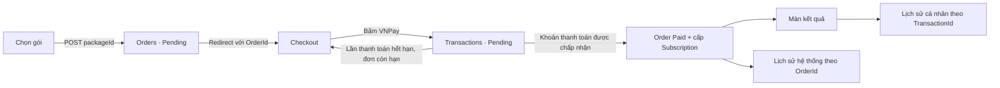

# Học code BF-01 và hai màn lịch sử giao dịch

## 1. BF và ràng buộc nghiệp vụ

[Sơ đồ BF-01 trong repo](diagrams/BF-01_Membership_Day_Pass_Purchase.drawio) đặt bán tại quầy ở **BF-01a**, mua online ở **BF-01b**, vé ngày ở **BF-01c**, đối soát và hoàn tiền ở **BF-01d**. Hai màn lịch sử bên dưới đọc dữ liệu sinh ra từ các nhánh đó. Các mã luật trong bảng được đối chiếu từ sơ đồ, schema hoặc chú thích code trong repo.

| Phần | Ràng buộc cần hiểu |
|---|---|
| **Loại gói** | Hai luồng bán trong tài liệu xử lý `Membership` và `DayPass`. Gói phải còn bán. JSP chọn gói cũng có thể hiện gói PT và nút Chọn buổi, dẫn sang chức năng đặt buổi riêng. |
| **Khách mua online** | Lấy tài khoản từ session, nối sang hồ sơ khách qua `PersonId`. Tài khoản phải `Active`, hồ sơ khác `Inactive`. Service chặn tạo đơn và bắt đầu thanh toán khi khách `Frozen`. Đơn online phải thuộc khách đang đăng nhập khi vào checkout. |
| **Đơn online** | `Online` bắt buộc có `PaymentDueAt`; `ShiftId` và `CreatedByEmployeeId` để trống. Hạn đơn lấy từ `P-09`, seed là **20 phút**. Tạo lại đơn online cùng khách và gói thì hủy đơn `Pending` cũ với `ReplacedByNewOrder`, trả lượt voucher nếu có (CBR-70/71). |
| **Link VNPay** | Link tối đa **5 phút** và không vượt hạn đơn. JOB-06 xử lý giao dịch quá hạn link; đơn vẫn có thể `Pending` để thử lại (CBR-69). JOB-05 xử lý đơn online quá hạn mà chưa có giao dịch thành công, đóng giao dịch đang chờ, trả lượt voucher và báo khách (CBR-70, BR-44). |
| **Giao dịch** | Mỗi đơn có tối đa một giao dịch `Pending` và một `Success` theo index lọc (DBR-42). Còn hạn đơn thì một lần thất bại/hết hạn có thể được theo sau bởi lần thử mới. Cần đọc kết quả xác nhận của server khi trình duyệt quay lại từ VNPay. QueryDR ở màn kết quả phụ thuộc cấu hình (CBR-125). |
| **Voucher và giá** | Mỗi đơn tối đa một mã. Kiểm tra cờ bật, ngày dùng, phạm vi `MembershipOnly` hoặc `MembershipAndDayPass`, giá tối thiểu trước giảm, tổng lượt và lượt theo khách (CBR-73/74/76). Gỡ mã online trả lại lượt cũ (BR-45). Giá lúc mua được lưu trong đơn, đã gồm VAT. VAT được tính trên tiền sau giảm theo `P-10` (DBR-57). |
| **Ca bán tại quầy** | Đơn `Counter` phải có lễ tân lập đơn và ca, `PaymentDueAt` để trống. Ca phải đang mở và thuộc ngày hiện tại (CBR-123). Lễ tân không bán cho hồ sơ của chính mình (CBR-115). |
| **Thu tiền tại quầy** | Chọn `Cash` hoặc `Transfer`. Chuyển khoản chỉ hoàn tất khi lễ tân xác nhận đã nhận đủ (CBR-77). Khi bán thành công, ghi người nhận tiền, đơn `Paid`, giao dịch và quyền tập trong cùng transaction DB. |
| **Hiệu lực gói** | `DayPass` dùng ngày thanh toán, `StartDate = EndDate` (CBR-34). `Membership` tính ngày theo thời hạn gói và có thể nối sau gói hiện tại (DBR-52). Đổi ngày sau mua áp dụng cho `Membership` đang `Active` và đủ điều kiện. Code xét ngày bắt đầu, lượt check-in, số lần đổi và gói tiếp theo. |
| **Lịch sử cá nhân** | Chỉ lấy giao dịch của đơn mà khách đang đăng nhập đứng tên. Query yêu cầu tài khoản `Active`, khách khác `Inactive`. Bộ lọc dựa trên trạng thái từng lần thanh toán: `Pending`, `Success`, `Failed`, `Expired`. |
| **Lịch sử hệ thống** | Danh sách manager lấy **đơn** làm dòng chính. Chi tiết đọc các lần thanh toán của đơn. Tab ca đọc ca đã đóng và cho xem các đơn của ca (BR-46, DBR-55). |
| **Hoàn tiền** | Giao dịch cần hoàn được đánh dấu `NeedsRefund`. Manager xác nhận khoản đã hoàn **ngoài hệ thống**. DB lưu thời điểm, người xác nhận và ghi chú (CBR-72, BR-47). Popup hiện link mở VNPay Merchant Portal để đối soát. |

[Schema](../database/1_Init_Schema.sql) · [Seed P-09/P-10](../database/2_Seed_Data.sql#L5456) · [Job hết hạn](../src/main/java/com/gms/service/PaymentMaintenanceService.java) · [Ngày hiệu lực](../src/main/java/com/gms/util/PackagePeriod.java) · [Đổi ngày sau mua](../src/main/java/com/gms/service/SubscriptionStartDateService.java)

### Ba ID để lần theo từ đầu đến cuối

```text
PackageId     = gói khách chọn trên danh mục
OrderId       = đơn mua gói đó của khách
TransactionId = một lần thanh toán của đơn đó
```

`Orders (1) ── (0..N) Transactions` và `Orders (1) ── (0..1) Subscriptions`. Lịch sử cá nhân đọc theo **lần thanh toán**, lịch sử hệ thống đọc theo **đơn**.

### Vòng đời của đơn, lần thanh toán và quyền tập

| Bảng | Được tạo khi nào | Chuyển trạng thái |
|---|---|---|
| `Orders` | Khách bấm mua online hoặc lễ tân chốt bán. | `Pending → Paid` khi thu tiền hợp lệ. Online `Pending → Cancelled` khi hết hạn đơn, bị thay thế hoặc nhận thanh toán sai số tiền. Đơn quầy `Pending/Paid → Cancelled` nếu được lễ tân hủy trong ca còn mở. |
| `Transactions` | Khi bắt đầu thanh toán online; tại quầy ghi thành công lúc chốt thu tiền. | Online `Pending → Success / Failed / Expired`. Callback VNPay thành công đến muộn có thể cập nhật `Expired → Success`. Khi đơn đã hủy hoặc tiền không khớp, giao dịch thành công có thể được đánh dấu `NeedsRefund` để đối soát. |
| `Subscriptions` | Khi đơn được thanh toán và cấp quyền, khởi tạo `Active`. | `Membership`: `Active ↔ Frozen` khi bảo lưu/mở lại, `Active → Expired` khi qua ngày cuối. `DayPass`: `Active → Used` khi check-in, hoặc `Active → Expired` nếu qua ngày mà chưa dùng. Hủy đơn quầy có thể chuyển quyền tập về `Cancelled`. |

Ví dụ đơn 123 có link đầu hết hạn: giao dịch 501 thành `Expired`, đơn vẫn `Pending`, chưa có quyền tập. Khách trả thành công ở lần 502: giao dịch 502 thành `Success`, đơn thành `Paid`, quyền tập được cấp ở `Active`. Khi quyền tập hết hạn, đơn vẫn `Paid`. Một `Subscription` có thể `Active` trước `StartDate`; phải xem cả khoảng ngày khi xét quyền vào tập.

[Callback VNPay](../src/main/java/com/gms/service/PaymentCallbackService.java#L194) · [Ghi đơn tại quầy](../src/main/java/com/gms/service/CounterSaleService.java#L784) · [Hủy quyền tập theo đơn](../src/main/java/com/gms/dao/ShiftDAO.java#L617)

## 2. Cách đọc từng màn

**Bấm gì → JSP/JS gửi gì → Servlet nhận gì → Service kiểm tra và quyết định gì → DAO đọc/ghi gì → trình duyệt nhận gì.**

Mở DevTools → Network → Preserve log. Trong code, `<a href>` mở GET, form dùng `method` trên thẻ form, và JS gọi `requestSubmit()` thì vẫn dùng method của form. Trong phản hồi, **forward** đưa dữ liệu sang JSP để trả HTML, **JSON** để JS cập nhật tại chỗ, **redirect** để trình duyệt mở URL tiếp theo.

Trong các ví dụ bên dưới, khách đăng nhập bằng `AccountId=8`, có `CustomerId=42`, chọn `PackageId=5`. Đơn online mới là `OrderId=123`, lần trả tiền là `TransactionId=501`. Đơn quầy là `OrderId=124`. Đây là ID minh họa để đọc từ trên xuống. Các bảng thao tác sau mỗi ví dụ dùng để tra từng nút.

### Đọc DTO cùng màn hình

DTO là object Java mang dữ liệu của một request hoặc một kết quả. Khi đọc DTO trả về, tìm **ai tạo object → Servlet đặt tên gì → JSP hoặc JS đọc trường nào**. Ví dụ, `${package1.options}` đọc `getOptions()` trên object mà Servlet đặt tên là `package1`. Với cờ boolean, `${option.purchasableOnline}` đọc `isPurchasableOnline()`.

| Màn | DTO đi từ đâu tới đâu |
|---|---|
| Chọn gói | [PackageSelectionView](../src/main/java/com/gms/dto/PackageSelectionView.java) chứa danh sách [PackageOptionView](../src/main/java/com/gms/dto/PackageOptionView.java). Servlet đặt view vào `package1`. JSP đọc `${package1.options}`, rồi đọc `${option.purchasableOnline}` để hiện nút mua. |
| Checkout | [CheckoutView](../src/main/java/com/gms/dto/CheckoutView.java) → Servlet đặt vào `checkout` → JSP đọc `${checkout.secondsLeft}` để cấp số giây cho JS. Phản hồi áp voucher được Servlet lấy từ view và đóng thành JSON riêng, JS đọc `totalText`. |
| Kết quả online | [PaymentResultView](../src/main/java/com/gms/dto/PaymentResultView.java) → Servlet đặt vào `result` → JSP đọc `${result.order.orderId}` để dựng link thử lại. |
| Bán tại quầy | [CounterCustomerRow](../src/main/java/com/gms/dto/CounterCustomerRow.java) → Servlet chọn trường và trả JSON để JS dựng kết quả tìm khách. [CounterVoucherResult](../src/main/java/com/gms/dto/CounterVoucherResult.java) mang kết quả báo giá. Khi bán thành công, [CounterSaleReceipt](../src/main/java/com/gms/dto/CounterSaleReceipt.java) đi qua session `lastReceipt` rồi vào JSP dưới tên `receipt`. |
| Lịch sử cá nhân | DAO dựng từng [TransactionHistoryItem](../src/main/java/com/gms/dto/TransactionHistoryItem.java) → Servlet đặt danh sách vào `historyItems` → JSP dùng `${item.transactionId}` để gắn đúng dòng với popup. |
| Lịch sử hệ thống | [ManagerTransactionItem](../src/main/java/com/gms/dto/ManagerTransactionItem.java) là một dòng trong danh sách đơn. [ManagerOrderDetailView](../src/main/java/com/gms/dto/ManagerOrderDetailView.java) là dữ liệu JSON khi bấm chi tiết, có thông tin các lần thanh toán dưới dạng [TransactionAttemptView](../src/main/java/com/gms/dto/TransactionAttemptView.java). |

Chiều đi vào cũng có DTO. Ở màn chọn gói, Servlet gom `keyword`, `type`, `sort`, `page` và các bộ lọc vào [PackageSearchCriteria](../src/main/java/com/gms/dto/PackageSearchCriteria.java) để đưa xuống Service. Khi xác nhận bán tại quầy, Servlet gom gói, khách, ngày, voucher và thông tin thu tiền vào [CounterCheckoutInput](../src/main/java/com/gms/dto/CounterCheckoutInput.java). `ServiceResult<T>` bọc kết quả thành công hoặc lỗi. Kiểu `T` cho biết dữ liệu ở bên trong, ví dụ `ServiceResult<PackageSelectionView>` chứa dữ liệu dựng màn chọn gói khi thành công.

## 3. Mua online



### Màn 1 — Chọn gói

Mở [sidebar khách](../src/main/webapp/WEB-INF/jsp/common/layout-customer.jspf#L32) → [package-selection.jsp](../src/main/webapp/WEB-INF/jsp/customer/package-selection.jsp) → [JS màn chọn gói](../src/main/webapp/js/pages/customer/package-selection.js).

**Lần theo đúng gói số 5**

1. **Bấm Mua gói ở sidebar.** Mở `layout-customer.jspf` và tìm `href="/customer/packages/purchase"` theo phần cuối của URL. Đây là link, nên trình duyệt gửi GET. Mở [Servlet chọn gói, đoạn GET](../src/main/java/com/gms/servlet/customer/PackageSelectionServlet.java#L50) và tìm dòng đặt thuộc tính `package1`. Đó là chỗ kết quả từ Java được đặt tên để JSP đọc.
2. **Tìm đúng thẻ gói.** Trong JSP, tìm `${package1.options}` rồi `${option.card.pkg}`. Mỗi `option` mang một gói và thông tin hiển thị như nhãn thời hạn. Với gói số 5, `${pkg.packageId}` thành `5`. ID này được dùng cả trong nút mở popup lẫn ô ẩn của form mua.
3. **Bấm Xem chi tiết trên thẻ số 5.** Tìm `data-dialog-target` ở nút và `id` ở thẻ `<dialog>`. Cả hai cùng có giá trị `packageDialog-5` (JS dùng giá trị trên nút để tìm dialog và mở). Kết quả là popup hiện ngay, Network không có request chi tiết.
4. **Bấm Mua ngay.** Từ nút `type="submit"` nhìn lên form ở [dòng 613](../src/main/webapp/WEB-INF/jsp/customer/package-selection.jsp#L613). `method="post"` cho biết Servlet chạy nhánh POST. `action` cho biết URL đích. Hai input ẩn cho biết Payload có `packageId=5` và `csrfToken`.
5. **Đọc từ chỗ nhận POST đến chỗ trả kết quả.** [Servlet](../src/main/java/com/gms/servlet/customer/PackageSelectionServlet.java#L96) nhận gói số 5 và lấy tài khoản số 8 từ session. Service tra ra khách số 42, kiểm tra gói, rồi DAO thêm dòng `Orders` và trả ID 123. Tìm dòng redirect. Nó gắn **123** vào URL checkout. Trong Network bạn sẽ thấy POST tạo đơn, sau đó là GET mở checkout.

| Bạn làm gì trên màn? | Dữ liệu đi đâu và xử lý thế nào? | Trả về gì? |
|---|---|---|
| Bấm **Mua gói** trên sidebar | Link GET `/customer/packages/purchase`. Servlet lấy tài khoản từ session, chuẩn bị CSRF và đọc tiêu chí URL. Service lấy gói đang bán từ `Packages`, chuẩn bị thẻ, bộ lọc và phân trang. | Forward `package1` về JSP. JSP hiện thẻ gói, thông báo rỗng hoặc lỗi tải. |
| Nhập tên rồi bấm **Tìm** | `packageFilterForm` có `method="get"` và đích `/customer/packages`. Ô `keyword` gắn vào form qua thuộc tính `form`. Service lọc theo chữ và tiêu chí hiện có. | HTML danh sách mới, ô tìm vẫn hiện từ khóa vừa gửi. |
| Đổi sắp xếp, chọn loại gói, tick thời hạn hoặc hình thức mua | Gửi `sort`, `type`, `duration`, `buy` cùng form (JS nghe `change`, gọi `requestSubmit()`). Ví dụ Vé ngày gửi `type=day-pass`. | HTML đã lọc/sắp xếp, JSP đánh dấu các lựa chọn còn bật. |
| Kéo giá, nhập giá, bấm **Áp dụng** | (JS đồng bộ hai thanh kéo và hai ô số.) Bấm Áp dụng gửi `minPrice`, `maxPrice`. | HTML có các gói khớp khoảng giá. |
| Bấm × trên chip, **Xóa tất cả**, hoặc đổi trang | (JS bỏ chip rồi submit, hoặc mở lại pathname khi xóa tất cả.) Link phân trang giữ tiêu chí và thay `page`. | HTML mới với tiêu chí và trang tương ứng. |
| Bấm **Bộ lọc** trên điện thoại | (JS đổi class của panel lọc.) | Mở/đóng panel tại chỗ. |
| Bấm **Xem chi tiết** rồi đóng popup | Nút `data-dialog-target` trỏ đến `packageDialog-<PackageId>` (JS mở dialog đã dựng sẵn, đóng khi bấm × hoặc vùng nền). | Hiện/ẩn tên, giá, mô tả, quyền lợi và nút hành động của đúng gói tại chỗ. |
| Bấm **Mua ngay** trên thẻ hoặc **Thanh toán ngay** trong popup | POST `/customer/packages/purchase` mang `packageId`, `csrfToken`. Servlet lấy `accountId` từ session. Service tìm khách, kiểm tra gói và xử lý đơn chờ cũ cùng gói nếu có. DAO lưu đơn `Online / Pending` với snapshot giá, VAT và hạn. | DAO trả **OrderId** → Servlet redirect `/customer/checkout?order=<OrderId>`. Hết phiên thì về đăng nhập, token sai trả 403, lỗi tạo đơn thì render lại với `purchaseError`. |

[Servlet chọn gói](../src/main/java/com/gms/servlet/customer/PackageSelectionServlet.java) · [Service danh mục](../src/main/java/com/gms/service/PackageSelectionService.java#L120) · [Service tạo đơn](../src/main/java/com/gms/service/PaymentService.java#L95) · [DAO ghi Orders](../src/main/java/com/gms/dao/OrderDAO.java#L120)

### Màn 2 — Checkout

Mở [checkout.jsp](../src/main/webapp/WEB-INF/jsp/customer/checkout.jsp) và [checkout.js](../src/main/webapp/js/pages/customer/checkout.js). Tìm hai form `voucherForm` và `paymentForm`.

**Lần theo một lần áp mã trên đơn 123**

1. **Nhập mã rồi nhấn Enter.** Tìm ô `id="voucherCode"` và các input ẩn `order`, `csrfToken` trong form. (JS bắt Enter và gửi POST đến `/customer/checkout` với `order=123`, `action=apply-voucher`, `voucherCode` và token.)
2. **Đọc nhánh `apply-voucher` trong [Servlet](../src/main/java/com/gms/servlet/customer/CheckoutServlet.java#L110).** Service nhận đơn, tài khoản và mã. Nó xác định đơn có thuộc khách và còn cho sửa không, kiểm tra voucher đủ điều kiện rồi cập nhật tiền giảm trên đơn.
3. **Mở Network → Response.** [Servlet đọc lại đơn](../src/main/java/com/gms/servlet/customer/CheckoutServlet.java#L201) rồi trả các trường như `voucherCode`, `discountText`, `totalText`, `vatText`, `preTaxText`. (JS lấy `totalText` gán vào phần tử `id="totalAmount"`, lấy `discountText` gán vào `id="discountAmount"`.) Đây là đường từ số tiền trong DB đến số tiền bạn thấy đổi ngay trên trang.
4. **Bấm thanh toán.** Form thứ hai gửi `action=pay` và vẫn dùng `order=123`. Service lấy số tiền từ đơn, chuẩn bị lần thanh toán và trả URL VNPay. Tìm `response.sendRedirect` trong nhánh `pay` để thấy chỗ mở trang VNPay.

| Bạn làm gì trên màn? | Dữ liệu đi đâu và xử lý thế nào? | Trả về gì? |
|---|---|---|
| Vào checkout từ màn chọn gói | GET `/customer/checkout?order=123`. Servlet nhận ID từ URL, Service tìm đơn của tài khoản hiện tại và tính số giây còn lại, tổng tiền, trạng thái sửa voucher. | Forward `checkout`, `order` về JSP. Hiện thông tin gói, giá, VAT, voucher và tổng tiền (JS đếm ngược, tải lại khi hết giờ). |
| Nhập voucher rồi nhấn Enter hoặc rời ô | (JS POST `action=apply-voucher`, `order`, `voucherCode`, `csrfToken`.) Service kiểm tra đơn còn cho sửa và các điều kiện mã. Nếu hợp lệ, DAO cập nhật voucher và số tiền trên đơn. | JSON chứa kết quả, thông báo và snapshot tiền hiện tại. JS cập nhật giảm giá, trước thuế, VAT, tổng tiền; mã sai hiện lỗi dưới ô. |
| Bấm × gỡ mã | (JS POST `action=remove-voucher`.) Service gỡ mã, trả lượt cũ và tính lại tiền. | JSON số tiền mới để JS cập nhật ngay trên trang. |
| Bấm thanh toán VNPay | (JS chờ request voucher rồi submit form.) POST `action=pay`, `order`, `csrfToken`. Service kiểm tra đơn và lấy số tiền từ DB, chuẩn bị giao dịch `Pending` và URL VNPay. | Redirect sang URL VNPay. Nếu thất bại, render checkout với `paymentError`. |

[Servlet checkout](../src/main/java/com/gms/servlet/customer/CheckoutServlet.java) · [Service thanh toán](../src/main/java/com/gms/service/PaymentService.java)

### Màn 3 — VNPay và kết quả

**Theo dõi hai kết nối khác nhau.** Mở [IPN Servlet](../src/main/java/com/gms/servlet/payment/VnPayIpnServlet.java) để xem nơi **VNPay gọi server**. Mở [Return Servlet](../src/main/java/com/gms/servlet/payment/VnPayReturnServlet.java) để xem nơi **trình duyệt quay về**. Sau khi kết quả được chấp nhận, tra `Transactions(501)` và `Orders(123)`. Bạn sẽ thấy hai trạng thái `Success` và `Paid` ở hai dòng khác nhau. JSP kết quả dùng dữ liệu đã đọc từ server để hiện tình trạng và khoảng hiệu lực của quyền tập.

| Sự kiện hoặc nút | Dữ liệu đi đâu và xử lý thế nào? | Trả về gì? |
|---|---|---|
| VNPay báo kết quả | VNPay gọi endpoint IPN. Server kiểm tra dữ liệu callback và đối chiếu lần thanh toán. Khoản được chấp nhận cập nhật giao dịch `Success`, đơn `Paid` và cấp `Subscriptions`. Có nhánh cần đối soát/hoàn tiền. | Phản hồi IPN cho VNPay. Đây là request giữa hai server. |
| Trình duyệt quay lại | Đường return nhận dữ liệu VNPay, xác định giao dịch. Màn kết quả đọc trạng thái đã lưu theo tài khoản. Return có thể đến trước IPN, khi đó trạng thái còn chờ xác nhận. | JSP kết quả hiển thị tình trạng thanh toán và quyền tập nếu đã cấp. |
| Bấm **thử lại** khi nút xuất hiện | Link về checkout mang `OrderId` cũ. Khi bấm trả, Service xét lại hạn và trạng thái đơn. | Checkout của cùng đơn; lần thử mới đủ điều kiện có giao dịch riêng. |
| Bấm **Đổi ngày** khi được phép | (JS gửi yêu cầu theo `SubscriptionId` và ngày chọn.) Service xét điều kiện đổi của `Membership`, đọc `CheckIns` và cập nhật ngày nếu hợp lệ. | Giao diện cập nhật khoảng hiệu lực hoặc hiện lỗi. |
| Bấm **Lịch sử giao dịch** | Link GET `/customer/transactions`. | Sang màn lịch sử cá nhân ở phần 5. |

[IPN Servlet](../src/main/java/com/gms/servlet/payment/VnPayIpnServlet.java) · [Return Servlet](../src/main/java/com/gms/servlet/payment/VnPayReturnServlet.java) · [Service kết quả](../src/main/java/com/gms/service/PaymentCallbackService.java) · [JSP kết quả](../src/main/webapp/WEB-INF/jsp/payment/payment-result.jsp)

## 4. Bán gói tại quầy

[Sidebar lễ tân](../src/main/webapp/WEB-INF/jsp/common/layout-receptionist.jspf#L65) → [Servlet bán gói](../src/main/java/com/gms/servlet/receptionist/CounterSaleServlet.java) → [JS dùng qua các bước](../src/main/webapp/js/pages/receptionist/counter-sale.js).

**Lần theo đường mở từng JSP**

```text
GET /receptionist/sales
    → counter-sale-packages.jsp
GET /receptionist/sales?package=5
    → counter-sale-customers.jsp, có selectedCard
GET /receptionist/sales?package=5&customer=42
    → counter-sale-next.jsp, có selectedCard + selectedCustomer
POST /receptionist/sales, packageId=5 và customerId=42
    → bán thành công, lưu lastReceipt trong session
    → redirect /receptionist/sales?receipt=124
    → counter-sale-receipt.jsp đọc biến receipt
```

Mở [form thu tiền](../src/main/webapp/WEB-INF/jsp/receptionist/counter-sale-next.jsp#L64). Hai input ẩn `packageId` và `customerId` lấy từ `selectedCard` và `selectedCustomer`. Nếu chọn **chuyển khoản**, tìm radio `paymentMethod=Transfer` và checkbox `transferReceived`. Khi submit, Service kiểm tra đã nhận tiền rồi mới lưu đơn. [Servlet đặt biên lai vào session và redirect](../src/main/java/com/gms/servlet/receptionist/CounterSaleServlet.java#L203)

| Màn và thao tác | Dữ liệu đi đâu và xử lý thế nào? | Trả về gì? |
|---|---|---|
| **Chọn gói** — mở menu Bán gói | GET `/receptionist/sales`. Service tải danh sách gói cho lễ tân. | [JSP danh mục quầy](../src/main/webapp/WEB-INF/jsp/receptionist/counter-sale-packages.jsp). |
| Gõ tên gói → chọn radio → bấm **Tiếp tục** | (JS lọc thẻ đang có và lấy ID radio đã chọn.) GET `/receptionist/sales?package=...`. Servlet tải thẻ gói đã chọn. | [JSP chọn khách](../src/main/webapp/WEB-INF/jsp/receptionist/counter-sale-customers.jsp). |
| **Chọn khách** — gõ từ khóa rồi chọn kết quả | (JS gọi `/receptionist/sales/customers`.) Service tìm khách. Khi chọn, trình duyệt mở GET có `package` và `customer`. Server tải hai đối tượng và chuẩn bị ngày dự kiến. | Tìm khách trả JSON gồm `customerId`, mã, tên, điện thoại, trạng thái và gói hiện tại. GET sau khi chọn trả [JSP thu tiền](../src/main/webapp/WEB-INF/jsp/receptionist/counter-sale-next.jsp). |
| **Thu tiền** — chọn ngày mặc định hoặc ngày khác | (JS cập nhật phần ngày hiển thị.) Form có `startDateMode`, `customStartDate` khi áp dụng. Vé ngày dùng hôm nay. | Phần ngày trên màn thay đổi; Service kiểm tra lại và tính khoảng ngày chính thức khi bán. |
| Nhập/gỡ voucher | (JS gọi endpoint `/receptionist/sales/voucher` với `package`, `customer`, mã.) Service kiểm tra điều kiện mã và tính mức giảm dự kiến. | JSON báo mức giảm hoặc lý do lỗi. JS cập nhật bảng tiền; mã hợp lệ được kiểm tra lại khi chốt đơn. |
| Chọn **Tiền mặt** hoặc **Chuyển khoản** | (JS đổi khối nhập theo radio `paymentMethod`.) Tiền mặt dùng `cashGiven` để hiển thị tiền thối. Chuyển khoản gửi `transferReceived` và `transferReference`. | Các trường và số tiền thối hiển thị tại chỗ. |
| Bấm **xác nhận bán** | POST `/receptionist/sales` mang `packageId`, `customerId`, CSRF và các trường thu tiền. Service kiểm tra ca hôm nay, gói, khách, ngày, voucher và thanh toán. DAO lưu đơn `Counter` gắn ca, ghi thanh toán, cấp quyền tập và commit cùng nhau. | Thành công mở [JSP biên lai](../src/main/webapp/WEB-INF/jsp/receptionist/counter-sale-receipt.jsp). Biên lai hiện đơn, khách, ngày, tiền và phương thức. Lỗi thì báo lý do và quay lại bước thu tiền. |

Đối chiếu ba cột sau khi bán: `Orders.ShiftId` là **ca bán**, `Orders.CreatedByEmployeeId` là **người lập đơn**, `Transactions.ReceivedByEmployeeId` là **người nhận tiền**. Nhánh tạo hồ sơ khách tại quầy thuộc phần quản lý hồ sơ.

[Xác nhận nhận chuyển khoản](../src/main/java/com/gms/service/CounterSaleService.java#L576) · [Ghi đơn, giao dịch và quyền tập](../src/main/java/com/gms/service/CounterSaleService.java#L784)

## 5. Lịch sử giao dịch cá nhân

[Sidebar khách](../src/main/webapp/WEB-INF/jsp/common/layout-customer.jspf#L37) → [transaction-history.jsp](../src/main/webapp/WEB-INF/jsp/customer/transaction-history.jsp) → [JS popup](../src/main/webapp/js/pages/customer/transaction-history.js).

**Lần theo nút Thành công rồi mở giao dịch 501.** Tìm link có `status=Success` trong JSP. Bấm link, Network hiện GET. DAO lọc theo trạng thái của **giao dịch**, rồi Servlet đặt danh sách vào `historyItems`, đặt `hasNext` để JSP quyết định có nút trang sau. Mỗi dòng dùng chính `transactionId` để gắn nút với dialog. Bấm giao dịch 501 (JS tìm `th-dialog-501` đã có trong HTML), rồi đối chiếu mã đơn và phương thức hiển thị với bản ghi `Transactions(501)`. [Servlet trả dữ liệu trang](../src/main/java/com/gms/servlet/customer/TransactionHistoryServlet.java#L41) · [Nút mở dialog](../src/main/webapp/WEB-INF/jsp/customer/transaction-history.jsp#L104)

| Bạn làm gì? | Dữ liệu đi đâu và xử lý thế nào? | Trả về gì? |
|---|---|---|
| Mở **Lịch sử giao dịch** | GET `/customer/transactions`. Servlet lấy tài khoản từ session. DAO đọc `Transactions`, nối đơn với khách đứng tên, nối khách với tài khoản qua `PersonId`. | HTML danh sách các lần thanh toán của khách. |
| Bấm một trạng thái hoặc chuyển trang | Link GET mang `status` hoặc `page`. DAO áp trạng thái giao dịch, Service/Servlet chuẩn bị dữ liệu trang. | HTML danh sách, trạng thái đang lọc và điều hướng trang. |
| Bấm một dòng, sau đó bấm **Đóng** | Nút `data-th-open` trỏ tới popup theo `TransactionId` (JS mở/đóng dialog đã render). | Hiện chi tiết giao dịch ngay trên màn. |
| Bấm nút trong popup | **Xem gói** mở `/customer/bookings?id=<SubscriptionId>`; **Mua lại** về danh mục; **Xem kết quả** mở `/customer/payment-result?transaction=<TransactionId>` khi nhánh tương ứng hiện nút. | HTML của màn đích. |

[Servlet lịch sử cá nhân](../src/main/java/com/gms/servlet/customer/TransactionHistoryServlet.java) · [Query lịch sử cá nhân](../src/main/java/com/gms/dao/TransactionHistoryDAO.java#L48)

## 6. Lịch sử giao dịch hệ thống

[Sidebar manager](../src/main/webapp/WEB-INF/jsp/common/layout-manager.jspf#L95) → [transaction-list.jsp](../src/main/webapp/WEB-INF/jsp/manager/transaction-list.jsp) → [JS lịch sử hệ thống](../src/main/webapp/js/pages/manager/transaction-list.js).

**Lần theo nút chi tiết của đơn 123.** Tìm nút chi tiết ở dòng đơn rồi bấm (JS gửi GET `/manager/transactions?action=detail&orderId=123`). Trong [nhánh detail của Servlet](../src/main/java/com/gms/servlet/manager/SystemTransactionServlet.java#L288), tìm chỗ trả JSON. DAO dùng 123 để đọc đơn và các lần thanh toán. Mở **Network → Response** rồi đối chiếu danh sách lần thanh toán với popup (JS dùng dữ liệu phản hồi để dựng nội dung). Với đơn quầy 124, đổi sang tab ca và so sánh `shiftId` trong request xem ca với `Orders.ShiftId` của đơn.

| Manager làm gì? | Dữ liệu đi đâu và xử lý thế nào? | Trả về gì? |
|---|---|---|
| Mở **Giao dịch**, tìm kiếm, lọc hoặc đổi trang | GET `/manager/transactions` với `tab`, `search`, `state`, `method`, `from`, `to`, `page`, `pageSize` tùy thao tác. Query bắt đầu từ `Orders`, lấy thông tin lần thanh toán gần nhất cho dòng đơn. | HTML danh sách đơn (JS có thể tải phản hồi và thay phần danh sách khi thao tác bộ lọc). |
| Bấm **chi tiết đơn** | (JS GET `action=detail&orderId=...`.) Server đọc người mua, snapshot gói, quyền tập và các lần thanh toán. | JSON chi tiết để JS dựng popup, hoặc JSON báo lỗi. |
| Chọn **tab ca**, lọc ngày, xem đơn của một ca | Tab ca đọc các ca đã đóng theo khoảng ngày. Khi bấm một ca (JS GET `action=shiftOrders&shiftId=...`), DAO tìm các đơn gắn ca đó. | HTML danh sách ca; JSON danh sách đơn khi mở chi tiết ca. |
| Mở popup **hoàn tiền** và đối soát | Popup lấy giao dịch cần hoàn theo `TransactionId`. Link Merchant Portal mở cổng VNPay để manager kiểm tra khoản thực thu. | Thông tin giao dịch và form ghi nhận hoàn tiền. |
| Bấm **xác nhận đã hoàn** | (JS POST `action=refund`, `transactionId`, `refundNote` và CSRF.) Service kiểm tra quyền và điều kiện giao dịch, DAO ghi người, thời điểm và ghi chú xác nhận. | JSON báo thành công hoặc lỗi. Form thường quay lại danh sách với thông báo. |
| Bấm **Xuất Excel** | Link GET `action=export` kèm tiêu chí đang lọc. Service truy vấn dữ liệu và tạo workbook. | File `.xlsx`. |

[Servlet manager](../src/main/java/com/gms/servlet/manager/SystemTransactionServlet.java) · [Service manager](../src/main/java/com/gms/service/ManagerTransactionService.java) · [DAO danh sách và chi tiết](../src/main/java/com/gms/dao/TransactionDAO.java)

## 7. Đối chiếu một đơn từ UI tới DB

Lấy `OrderId` từ URL checkout hoặc màn chi tiết manager. Dùng một ID online rồi lặp lại với một ID tại quầy.

```sql
DECLARE @OrderId INT = 123;

SELECT OrderId, OrderCode, Channel, Status, ShiftId, PaymentDueAt
FROM Orders WHERE OrderId = @OrderId;

SELECT TransactionId, PaymentMethod, Status, Amount, ExpiresAt, NeedsRefund
FROM Transactions WHERE OrderId = @OrderId ORDER BY TransactionId;

SELECT SubscriptionId, SubscriptionType, StartDate, EndDate, Status
FROM Subscriptions WHERE OrderId = @OrderId;
```

Đọc lại một thao tác qua cả bốn điểm. Ví dụ: **Bấm Mua ngay → Network có POST mang PackageId → response redirect có OrderId → DB có Orders.Pending**. Sau khi thanh toán, tìm lại cùng `OrderId` trên màn manager và đối chiếu từng `TransactionId` ở lịch sử cá nhân.
