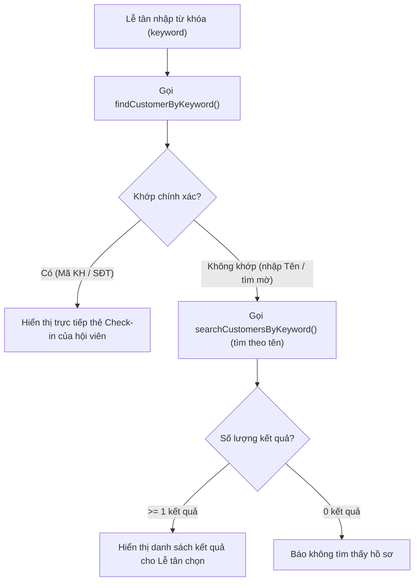

# Tài Liệu Giải Thích Logic Tìm Kiếm Khách Hàng Khi Check-in

Tài liệu này giải thích chi tiết hai phương thức tra cứu và tìm kiếm khách hàng trong [`CheckInDAO.java`](../src/main/java/com/gms/dao/CheckInDAO.java) phục vụ nghiệp vụ Check-in tại quầy Lễ tân (màn hình `/receptionist/check-in`).

---

## 1. Tổng Quan Luồng Tìm Kiếm Khi Check-in

Hệ thống kết hợp **2 phương thức** để tối ưu tốc độ và độ tiện dụng cho Lễ tân:



---

## 2. Hàm 1: Tra Cứu Chính Xác — `findCustomerByKeyword(String keyword)`

### Mục đích
Tra cứu hồ sơ khi Lễ tân nhập **Mã khách hàng** (hoặc quét mã QR) hoặc nhập **Số điện thoại**. Vì hai thông tin này là **duy nhất**, hệ thống sẽ mở trực tiếp thẻ check-in của hội viên.

### Đoạn mã nguồn
```java
public CustomerLookupInfo findCustomerByKeyword(String keyword) throws SQLException {
    String sql = "SELECT cust.CustomerId, cust.PersonId, cust.CustomerCode, cust.CheckInPhoto, "
            + "cust.CustomerType, cust.Status AS CustomerStatus, p.FullName, p.Phone, p.Avatar "
            + "FROM Customers cust "
            + "JOIN Persons p ON cust.PersonId = p.PersonId "
            + "WHERE (UPPER(cust.CustomerCode) = UPPER(?) OR p.Phone = ?) "
            + "  AND cust.DeletedAt IS NULL";

    try (Connection conn = DBContext.getConnection();
         PreparedStatement stmt = conn.prepareStatement(sql)) {
        stmt.setString(1, keyword.trim());
        stmt.setString(2, keyword.trim());
        try (ResultSet rs = stmt.executeQuery()){
            if (rs.next()) {
                CustomerLookupInfo info = new CustomerLookupInfo();
                info.customerId = rs.getInt("CustomerId");
                info.personId = rs.getInt("PersonId");
                info.customerCode = rs.getString("CustomerCode");
                info.checkInPhoto = rs.getString("CheckInPhoto");
                info.customerType = rs.getString("CustomerType");
                info.customerStatus = rs.getString("CustomerStatus");
                info.fullName = rs.getString("FullName").trim();
                info.phone = rs.getString("Phone");
                info.avatar = rs.getString("Avatar");
                return info;
            }
        }
    }
    return null;
}
```

### Giải thích chi tiết từng thành phần:

1. **`JOIN Persons p ON cust.PersonId = p.PersonId`**:
   - Dữ liệu hội viên được tách làm 2 bảng:
     - `Customers`: Chứa mã khách, trạng thái hoạt động, ảnh chụp check-in tại quầy.
     - `Persons`: Chứa thông tin cá nhân như họ tên, số điện thoại, ảnh đại diện (avatar).
   - Phép `JOIN` giúp gom đầy đủ dữ liệu hiển thị cho quầy Lễ tân chỉ trong 1 lần truy vấn.

2. **`cust.DeletedAt IS NULL`**:
   - Áp dụng cơ chế **xóa mềm (soft delete)**: Khách hàng đã bị xóa sẽ không xuất hiện trong kết quả tìm kiếm.

3. **Điều kiện lọc định danh duy nhất trong `WHERE (...)`**:
   - `UPPER(cust.CustomerCode) = UPPER(?)`: Khớp mã khách hàng mà **không phân biệt hoa/thường** (ví dụ: gõ `kh-0001` hay `KH-0001` đều tìm thấy).
   - `p.Phone = ?`: Khớp chính xác số điện thoại (ví dụ: `0987654321`).
   - *Lưu ý*: Hàm này **không tìm theo Họ và tên** để tránh việc có 2 khách hàng trùng tên thì người thứ hai bị bỏ sót. Mọi tìm kiếm theo tên sẽ do `searchCustomersByKeyword` xử lý để luôn hiển thị danh sách cho Lễ tân chọn.

4. **An toàn kết nối và bảo mật**:
   - **`try-with-resources`**: Đảm bảo đóng `Connection`, `PreparedStatement` và `ResultSet` ngay sau khi dùng xong, tránh rò rỉ kết nối database (connection leak).
   - **`keyword.trim()`**: Cắt bỏ khoảng trắng thừa ở 2 đầu chuỗi.
   - **`PreparedStatement`**: Truyền tham số qua các dấu `?`, chống hoàn toàn lỗi bảo mật **SQL Injection**.

5. **Xử lý kết quả trả về**:
   - Dùng `if (rs.next())`: Vì tra cứu chính xác, nếu có bản ghi khớp thì đọc dữ liệu gán vào DTO `CustomerLookupInfo` và `return` ngay.
   - Nếu không có dòng nào khớp, trả về `null`.

---

## 3. Hàm 2: Tìm Kiếm Theo Tên Có Phân Trang (Pagination)

### Mục đích
Khi Lễ tân **tìm theo tên** của khách (ví dụ: gõ *"Nga"*, *"Bùi"*, *"Minh"*...) và exact match không tìm thấy, hệ thống sẽ tìm kiếm theo tên và **phân trang (10 khách/trang)**.
- **Không bỏ sót khách hàng**: Nếu có 50 hay 100 khách khớp từ khóa, Lễ tân có thể lật sang Trang 2, Trang 3... để xem hết.
- **Không gây đơ/lag hệ thống**: Mỗi trang chỉ tải đúng 10 bản ghi bằng `OFFSET ? ROWS FETCH NEXT ? ROWS ONLY`.

### Đoạn mã nguồn
```java
// 1. Đếm tổng số bản ghi khớp
public long countCustomersByKeyword(String keyword) throws SQLException {
    String sql = "SELECT COUNT(*) FROM Customers cust "
            + "JOIN Persons p ON cust.PersonId = p.PersonId "
            + "WHERE cust.DeletedAt IS NULL "
            + "  AND p.FullName COLLATE Latin1_General_100_CI_AI LIKE ? ESCAPE '\\'";
    // ...
}

// 2. Lấy dữ liệu của trang hiện tại
public List<CustomerSearchItem> searchCustomersByKeyword(String keyword, int pageNumber, int pageSize) throws SQLException {
    int offset = Math.max(0, (pageNumber - 1) * pageSize);
    String sql = "SELECT cust.CustomerId, cust.CustomerCode, p.FullName, p.Phone, "
            + "cust.Status AS CustomerStatus, cust.CheckInPhoto "
            + "FROM Customers cust "
            + "JOIN Persons p ON cust.PersonId = p.PersonId "
            + "WHERE cust.DeletedAt IS NULL "
            + "  AND p.FullName COLLATE Latin1_General_100_CI_AI LIKE ? ESCAPE '\\' "
            + "ORDER BY p.FullName, cust.CustomerId "
            + "OFFSET ? ROWS FETCH NEXT ? ROWS ONLY";
    // ...
}
```

### Giải thích chi tiết từng thành phần:

1. **`OFFSET ? ROWS FETCH NEXT ? ROWS ONLY`**:
   - Chuẩn phân trang của SQL Server (tương ứng `LIMIT ... OFFSET ...` của MySQL).
   - Trang 1 (`pageNumber = 1, pageSize = 10`): Bỏ qua 0 dòng, lấy 10 dòng đầu.
   - Trang 2 (`pageNumber = 2, pageSize = 10`): Bỏ qua 10 dòng, lấy 10 dòng tiếp theo.

2. **`p.FullName COLLATE Latin1_General_100_CI_AI LIKE ? ESCAPE '\\'`**:
   - `LIKE ?`: Phép tìm kiếm chứa chuỗi (tương đương `%keyword%`).
   - `COLLATE Latin1_General_100_CI_AI`:
     - **CI** (*Case Insensitive*): **Không phân biệt chữ hoa và chữ thường** (`nga`, `Nga`, `NGA` đều như nhau).
     - **AI** (*Accent Insensitive*): **Không phân biệt dấu thanh lẫn dấu mũ/móc** (`ta` tìm ra cả `Tạ` và `Tâm`, `do` tìm ra `Đỗ`, `dung` tìm ra `Dũng`).
   - `ESCAPE '\\'`: Khai báo dấu `\` là ký tự thoát (escape). Nếu trong từ khóa của người dùng có ký tự đại diện của SQL (`%`, `_`, `[`), dấu `\` sẽ giúp SQL hiểu đó là chữ bình thường, tránh lỗi cú pháp.

3. **`SqlUtil.toContainsPattern(keyword)`**:
   - Chuẩn hóa từ khóa thành dạng `%keyword%`.
   - Tự động chèn dấu `\` trước các ký tự đặc biệt (`%`, `_`, `[`, `\`) theo chuẩn `GBR-19`.

4. **`ORDER BY p.FullName`**:
   - Sắp xếp kết quả trả về theo thứ tự bảng chữ cái của tên để Lễ tân dễ quét mắt và bấm chọn.

5. **Xử lý vòng lặp `while (rs.next())`**:
   - Khác với `findCustomerByKeyword` chỉ lấy 1 dòng (`if`), ở đây dùng vòng lặp `while` để lấy **tất cả các khách hàng trùng khớp**.
   - Mỗi khách hàng được đóng gói vào 1 đối tượng `CustomerSearchItem` gồm: `CustomerId`, `CustomerCode`, `FullName`, `Phone`, `CustomerStatus`, `CheckInPhoto`.
   - Đưa vào `list` và trả về cho Service/Servlet hiển thị lên giao diện.

---

## 4. So Sánh Hai Phương Thức

| Tiêu chí | `findCustomerByKeyword` | `searchCustomersByKeyword` |
| :--- | :--- | :--- |
| **Mục đích** | Tra cứu chính xác | Tìm kiếm mờ / gợi ý |
| **Phạm vi tìm kiếm** | Mã khách hàng hoặc SĐT (Định danh duy nhất) | **Họ và tên (`FullName`)** (1 phần hoặc đủ họ tên) |
| **Toán tử SQL** | Phép so sánh bằng `=` | Phép so sánh tương đối `LIKE` |
| **Số lượng kết quả** | Tối đa **1** khách hàng (`CustomerLookupInfo`) | Danh sách **nhiều** khách hàng (`List<CustomerSearchItem>`) |
| **Xử lý chữ hoa/thường** | Không phân biệt mã KH (`UPPER`) | Không phân biệt (`Latin1_General_100_CI_AI`) |
| **Xử lý dấu tiếng Việt** | Không áp dụng (Mã KH và SĐT là số/chữ Latin) | Không phân biệt dấu thanh + dấu mũ/móc |
| **Thời điểm gọi** | Gọi đầu tiên khi Lễ tân bấm tìm kiếm | Gọi khi tra cứu không khớp Mã KH hoặc SĐT |
