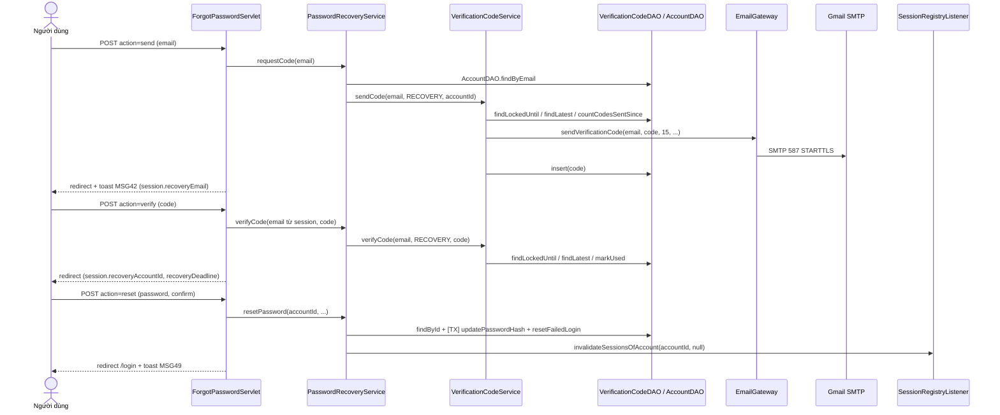

# 03 · Đi sâu 4 luồng: Email · BCrypt · Quên mật khẩu · Đặt mật khẩu qua link

> Cách đọc: mỗi luồng có **(1) bản đồ gọi hàm** (hàm nào → hàm nào), **(2) các bước trong từng hàm** (B1, B2… khớp comment trong code),
> **(3) dữ liệu DB thay đổi**, **(4) chi tiết "bẫy" giáo viên hay hỏi**. Không cần đọc từng dòng code — nhớ được bản đồ và các bước là đủ review.
>
> Ký hiệu: `A ─► B` = A gọi B · `⟲` = quay về · `[DB]` = chạm database · `[MAIL]` = ra Internet · `✔/✘` = nhánh thành công/thất bại.

---

# PHẦN 1 — LUỒNG EMAIL (API-03) TRONG KIẾN TRÚC

## 1.1 EmailGateway đứng ở đâu

```
Servlet ──► Service ──► EmailGateway ──SMTP 587/STARTTLS──► smtp.gmail.com ──► hộp thư người nhận
                ▲             │
                └─ EmailSendException (checked) ◄┘   → Service đổi thành MSG04 cho người dùng
```

- **Chỉ Service được gọi EmailGateway** (không bao giờ Servlet gọi thẳng) → nghiệp vụ quyết định *khi nào* gửi, Gateway chỉ lo *gửi thế nào*.
- Đây là **Gateway pattern**: mai đổi Gmail sang SendGrid/Amazon SES chỉ sửa 1 lớp, Service không đổi.
- Actor "Email / OTP Service" trên Use Case và Context Diagram của SRS chính là khối này.

| Ai gọi | Gọi hàm nào | Khi nào |
|---|---|---|
| `VerificationCodeService.sendCode` | `sendVerificationCode(email, code, 15, "khôi phục mật khẩu")` | Quên mật khẩu, (sắp tới) đăng ký, kích hoạt, đổi email/SĐT |
| `ContactChangeService.applyEmailChange` | `sendNotice(emailCũ, "Email đăng nhập đã được thay đổi", …)` | Đổi email xong (CBR-29) — chưa nối servlet |
| (TV4 — chưa code) Lễ tân tạo TK | `sendPasswordSetupLink(email, link, 15)` | CBR-24 |

## 1.2 Cấu hình (application.properties — gitignore)

```properties
mail.smtp.host=smtp.gmail.com
mail.smtp.port=587
mail.username=<gmail hệ thống>          # người GỬI
mail.app-password=<16 ký tự, viết liền>  # App Password, KHÔNG phải mật khẩu Gmail
mail.from-name=Super Gym                 # không bắt buộc
```
App Password: bật **Xác minh 2 bước** cho Gmail → `myaccount.google.com/apppasswords` → tạo mật khẩu ứng dụng. Gmail **không cho** đăng nhập SMTP bằng mật khẩu thường.

## 1.3 Bản đồ hàm bên trong EmailGateway

```
PUBLIC (soạn nội dung)                         PRIVATE (kỹ thuật)
sendVerificationCode(to, code, minutes, purpose) ─┐
sendPasswordSetupLink(to, link, minutes)        ──┼─► send(to, subject, html, text)
sendNotice(to, subject, plainMessage)           ──┘        ├─► AppConfig.get("mail.username" / "mail.app-password" / "mail.from-name")
                                                           ├─► isMailNotConfigured(appPassword)  ── true ──► System.out "[DEV EMAIL] …" ⟲ return
                                                           ├─► createMailSession(username, appPassword)
                                                           │       └─► AppConfig.get("mail.smtp.host"/"mail.smtp.port") → Properties → Session.getInstance(…, Authenticator)
                                                           ├─► wrapInLayout(html)        (khung SUPER GYM, style inline)
                                                           ├─► Transport.send(message)   [MAIL]
                                                           └─ catch MessagingException | UnsupportedEncodingException
                                                                  → printStackTrace → throw new EmailSendException(…)
escapeHtml(value)  ← mọi chuỗi động (mã, mục đích, link) đều đi qua đây trước khi ghép vào HTML
```

## 1.4 Từng hàm làm gì

**`sendVerificationCode(toEmail, code, validMinutes, purpose)`**
1. Tiêu đề = `"[Super Gym] Mã xác thực " + purpose` (VD "…khôi phục mật khẩu").
2. Soạn **bản HTML**: lời chào, mã in to nền vàng chanh, "hiệu lực 15 phút, chỉ dùng 1 lần", cảnh báo "không chia sẻ mã". Mọi giá trị động qua `escapeHtml`.
3. Soạn **bản chữ thường** cùng nội dung.
4. Gọi `send(...)`.

**`sendPasswordSetupLink(toEmail, link, validMinutes)`** — giống trên, nội dung là nút "Đặt mật khẩu" + link dự phòng dạng chữ.
**`sendNotice(toEmail, subject, plainMessage)`** — 1 đoạn văn, tự thêm tiền tố `[Super Gym]`.

**`send(toEmail, subject, contentHtml, contentText)`** — trái tim của luồng email:

| Bước | Làm gì | Vì sao |
|---|---|---|
| B1 | Đọc `mail.username`, `mail.app-password`, `mail.from-name` | Bí mật không viết cứng trong code |
| B2 | App Password bắt đầu `xxxx…` → **chế độ DEV**: in `[DEV EMAIL] To… Subject… + nội dung` ra console Tomcat, `return` | Cả nhóm test được mà không cần Gmail |
| B3 | Dựng `MimeMessage`: From (tên hiển thị UTF-8), To, Subject UTF-8, ngày gửi; 2 phần `text/plain` + `text/html` (HTML đã bọc khung) trong `MimeMultipart("alternative")` — phần HTML **đứng sau** | Tiếng Việt không lỗi font; "alternative" = trình đọc thư chọn bản tốt nhất nó hiển thị được → ít bị Spam |
| B4 | `Transport.send(message)` — **chặn** tới khi Gmail nhận xong (1–5 s), tối đa 10 s | Gửi đồng bộ để biết ngay thành/bại |
| B5 | Lỗi → in stack trace (cho dev) → ném `EmailSendException` (checked) | Buộc Service phải xử lý, không được "quên" |

**`createMailSession(username, appPassword)`** — cấu hình SMTP:

| Thuộc tính | Giá trị | Ý nghĩa |
|---|---|---|
| `mail.smtp.auth` | true | Đăng nhập SMTP bằng username + App Password (qua `Authenticator`) |
| `mail.smtp.starttls.enable` / `.required` | true / true | Cổng 587: kết nối thường rồi **nâng lên TLS**; `required` = không nâng được thì **không gửi** (không bao giờ gửi mật mã/mã OTP ở dạng rõ) |
| `mail.smtp.ssl.trust` | = host | Tin chứng chỉ của đúng `smtp.gmail.com` — tránh lỗi PKIX khi antivirus chen giữa |
| `mail.smtp.ssl.protocols` | `TLSv1.2 TLSv1.3` | Cấm TLS cũ yếu |
| `connectiontimeout`, `timeout`, `writetimeout` | 10000 ms | Gmail không trả lời → không treo request mãi |

## 1.5 Cuộc hội thoại SMTP (để giải thích "STARTTLS" bằng lời)

```
GMS                                       smtp.gmail.com:587
 │── kết nối TCP ─────────────────────────►│
 │── EHLO ────────────────────────────────►│  "chào, anh hỗ trợ gì?"
 │◄─ 250 STARTTLS, AUTH … ─────────────────│
 │── STARTTLS ────────────────────────────►│  "chuyển sang mã hóa"
 │◄═══════ bắt tay TLS 1.2/1.3 ═══════════►│  từ đây mọi thứ được MÃ HÓA
 │── AUTH (username + App Password) ──────►│
 │── MAIL FROM / RCPT TO / DATA (thư) ────►│
 │◄─ 250 OK ───────────────────────────────│  Transport.send() trả về
```

## 1.6 Nguyên tắc "GỬI MAIL TRƯỚC — GHI DB SAU"

Trong `VerificationCodeService.sendCode`: **B6 gửi email → B7 mới INSERT** dòng mã.
- Gửi lỗi (sai App Password, mất mạng) → dừng, **DB không có dòng rác**, người dùng thấy MSG04 và bấm lại được ngay (không bị tính vào luật 60 giây / 5 lần/giờ vì chưa có dòng nào).
- Ngược lại nếu INSERT trước rồi gửi lỗi: DB có mã "ma", người dùng bị bắt chờ 60 s cho một mã họ không hề nhận.
- Đánh đổi (nói được là ăn điểm): nếu gửi **thành công** nhưng INSERT **lỗi** → khách có mã nhưng DB không có → nhập sẽ báo MSG44 → khách bấm gửi lại. Xác suất rất thấp, hậu quả nhẹ.
- Cùng tinh thần cho đăng ký (theo luật API-03): gửi mã lỗi → **không tạo tài khoản**.

## 1.7 Bẫy & câu hỏi hay gặp

| Câu hỏi | Trả lời ngắn |
|---|---|
| Vì sao không dùng cổng 465? | 465 = SSL ngay từ đầu (SMTPS); 587 = STARTTLS là cổng submission chuẩn. Cả 2 đều mã hóa; nhóm chọn 587 + `starttls.required`. |
| Vì sao có cả bản text lẫn HTML? | `multipart/alternative`: trình đọc thư cũ/không HTML vẫn đọc được; bộ lọc spam đánh giá cao thư có cả 2 bản. |
| Vì sao style inline? | Gmail bỏ thẻ `<style>` → phải viết `style="…"` trên từng thẻ. |
| Có bị chèn HTML/XSS vào email không? | Mọi giá trị động qua `escapeHtml` (`& < > " '`). |
| Chế độ dev bật khi nào? | Khi `mail.app-password` bắt đầu bằng `xxxx`. ⚠ Nếu **xóa hẳn** khóa này, `AppConfig.get` ném `IllegalStateException` → trang 500 (không vào chế độ dev) — nên dùng `AppConfig.get(key, "")`. |
| Gửi mail có làm request chậm không? | Có (1–5 s) vì gửi đồng bộ. Cải tiến: hàng đợi / `ExecutorService` gửi bất đồng bộ — nhưng khi đó phải xử lý "gửi lỗi sau khi đã báo thành công". |
| Lộ App Password thì sao? | Vào Google Account thu hồi App Password đó, tạo cái mới; không cần đổi code. |

---

# PHẦN 2 — LUỒNG BCRYPT (mật khẩu)

## 2.1 Ai gọi BCrypt

```
                          PasswordUtil  (final class, constructor private, chỉ Service gọi)
                          ├─ hashPassword(raw)            ← dùng khi GHI mật khẩu mới
                          └─ checkPassword(raw, hash)     ← dùng khi SO mật khẩu
hashPassword được gọi bởi:                          checkPassword được gọi bởi:
  RegistrationService.createNewCustomerTransaction     AuthService.login  (B7)
  RegistrationService.claimExistingAccount             AccountSettingsService.changePassword
  PasswordRecoveryService.savePasswordAndUnlock           ├ B2: mật khẩu hiện tại đúng không
     (← resetPassword · setPasswordByLink)                └ B4: mật khẩu mới có TRÙNG mật khẩu cũ không (MSG48)
  AccountSettingsService.changePassword (B7)
```

## 2.2 `hashPassword(rawPassword)` — 2 bước

```
B1  salt = BCrypt.gensalt(10)          → "$2a$10$" + 22 ký tự salt ngẫu nhiên (16 byte)
B2  return BCrypt.hashpw(raw, salt)    → chuỗi 60 ký tự, VD:
    $2a$10$N9qo8uLOickgx2ZMRZoMye  IjZAgcfl7p92ldGxad68LJZdL17lhWy
    └┬┘└┬┘└──────── salt 22 ───────┘└──────────── hash 31 ─────────────┘
   phiên  cost = 10 → 2^10 = 1024 vòng lặp khóa (key expansion)
   bản
```
- **Salt nằm ngay trong chuỗi hash** → DB **không cần cột salt**.
- Cùng 1 mật khẩu băm 2 lần → **2 chuỗi khác nhau** (salt khác) → hai người trùng mật khẩu vẫn không nhìn ra.
- Cột `Accounts.PasswordHash VARCHAR(255)` (cần ≥ 60).

## 2.3 `checkPassword(rawPassword, passwordHash)` — 3 bước

```
B1  raw == null hoặc hash == null (tài khoản chưa đặt mật khẩu) → return false
B2  BCrypt.checkpw(raw, hash):
      đọc "$2a$" + cost "10" + salt 22 ký tự từ CHÍNH chuỗi hash
      băm lại raw với đúng salt + cost đó
      so sánh 2 kết quả (so từng byte, không dừng sớm)
B3  hash sai định dạng (VD seed giả, tiền tố $2b$ mà jBCrypt 0.4 không đọc) → IllegalArgumentException → return false
```
→ BCrypt **không giải mã** được; "kiểm tra" = **băm lại rồi so**.

## 2.4 Vì sao BCrypt mà không SHA-256 / MD5

| Tiêu chí | MD5 / SHA-256 (thuần) | BCrypt |
|---|---|---|
| Tốc độ | Cực nhanh (GPU thử hàng tỷ lần/giây) → brute-force dễ | **Chậm có chủ đích** (~0,1 s/lần với cost 10) |
| Salt | Phải tự làm, hay quên | **Tự sinh, tự lưu** trong chuỗi |
| Rainbow table | Bị (nếu không salt) | Vô dụng (mỗi hash 1 salt riêng) |
| Nâng độ khó theo thời gian | Không | Tăng cost +1 = chậm **gấp đôi**; hash cũ vẫn kiểm tra được vì cost nằm trong chuỗi |

Còn SHA-256 trong dự án dùng cho **token link** (mục phần 4): token đã là 32 byte ngẫu nhiên (entropy cao, không đoán được) nên chỉ cần băm nhanh để lộ DB không dùng được — khác với mật khẩu người đặt (entropy thấp, dễ đoán) nên phải băm **chậm**.

## 2.5 Hai kịch bản dùng BCrypt

```
ĐĂNG NHẬP (AuthService.login — B7)
  account.PasswordHash (từ DB) + password (form)
  ─► PasswordUtil.checkPassword(password, hash)
      ✔ → B8: reset bộ đếm, LastLoginAt
      ✘ → khách: increaseFailedLogin (+ lockUntil nếu đủ 5) · NV: MSG34

ĐỔI MẬT KHẨU (AccountSettingsService.changePassword)
  B2  checkPassword(current, hash)  ✘ → "Mật khẩu hiện tại không đúng."
  B3  isValidPassword(new)          ✘ → luật 8–64 chữ+số
  B4  checkPassword(new, hash)      ✔ → "Mật khẩu mới phải khác mật khẩu hiện tại." (MSG48)  ← mẹo: so mật khẩu mới với HASH cũ
  B7  hashPassword(new) ─► AccountDAO.updatePasswordHash
  B8  SessionRegistryListener.invalidateSessionsOfAccount(id, session.getId())  → giữ phiên đang dùng
```

## 2.6 Bẫy & câu hỏi

| Câu hỏi | Trả lời |
|---|---|
| Sao biết "mật khẩu mới khác mật khẩu cũ" khi không lưu mật khẩu cũ? | Dùng `checkPassword(new, oldHash)` — nếu khớp tức là trùng. |
| Có giới hạn độ dài không? | BCrypt chỉ dùng **72 byte** đầu; dự án giới hạn 64 ký tự (với ký tự có dấu UTF-8 có thể > 64 byte nhưng vẫn ≤ 72 trong hầu hết trường hợp). |
| Seed dữ liệu đăng nhập kiểu gì? | `database/3_Dev_Passwords.sql` ghi hash BCrypt thật của `Gms@2026` cho mọi tài khoản mẫu. |
| Đổi cost 10 → 12 có hỏng tài khoản cũ không? | Không — cost của từng hash nằm trong chuỗi; hash mới sẽ dùng 12. |
| Mật khẩu có bị log ra không? | Không: Service không in mật khẩu; Servlet đọc `getParameter("password")` **không trim**; JSP không bao giờ đổ lại ô mật khẩu. |

---

# PHẦN 3 — LUỒNG QUÊN MẬT KHẨU (UC-03) — CHI TIẾT TỪNG HÀM

## 3.1 Máy trạng thái (lưu trong session)

```
            send ✔                        verify ✔                        reset ✔
 [EMAIL] ─────────────► [CODE] ──────────────────────────► [RESET] ─────────────────► /login + MSG49
 (không có key)   recoveryEmail                 + recoveryAccountId              xóa 3 key
                                                + recoveryDeadline (= ExpiresAt của mã)
   ▲   GET ?restart=1 (nút "Dùng email khác") xóa cả 3 key  │  quá recoveryDeadline → xóa 3 key, MSG44
   └────────────────────────────────────────────────────────┘
```
`ForgotPasswordServlet.resolveStep(session)`: có `recoveryAccountId` → **reset**; có `recoveryEmail` → **code**; không → **email**.
→ Người dùng **không thể nhảy thẳng** sang bước sau bằng cách sửa HTML/URL, vì bước do **server** quyết định.

## 3.2 Bản đồ tổng (4 action POST + 1 GET)

```
ForgotPasswordServlet (@WebServlet("/forgot-password"))
│
├─ doGet ─► [restart=1] clearRecovery → redirect
│         └► showCurrentStep ─► resolveStep ─► (reset & isResetExpired → clearRecovery, lỗi MSG44)
│                             └► forwardStep ─► (bước code) setCodeTimers ─► passwordRecoveryService.findLatestRecoveryCode ─► DAO.findLatestByEmailAndPurpose [DB]
│                                           └► RequestUtil.forward("auth/forgot-password")
│
└─ doPost ─► switch(action)
     ├ "send"   ─► handleSend   ─► PasswordRecoveryService.requestCode ─► VerificationCodeService.sendCode ─► EmailGateway [MAIL]
     ├ "resend" ─► handleResend ─► PasswordRecoveryService.requestCode (email lấy từ SESSION)
     ├ "verify" ─► handleVerify ─► PasswordRecoveryService.verifyCode  ─► VerificationCodeService.verifyCode
     ├ "reset"  ─► handleReset  ─► PasswordRecoveryService.resetPassword ─► savePasswordAndUnlock (transaction) ─► SessionRegistryListener
     └ khác     ─► redirect /forgot-password
```

## 3.3 Bước 1 — POST `action=send`

```
ForgotPasswordServlet.handleSend(request, response, session)
│ email = RequestUtil.getTrimmedParam(request, "email")
├─► PasswordRecoveryService.requestCode(email)
│     B1  ValidationUtil.isNullOrEmpty(email)  → failField("email", MSG09 "Email là bắt buộc.")
│         ValidationUtil.isValidEmail(email)   → failField("email", MSG11)      ← nhập SĐT rơi vào đây (BR-03)
│     B2  AccountDAO.findByEmail(email)  [DB]  SELECT … FROM Accounts JOIN Persons WHERE Email=? AND IsReleased=0
│         null → failField("email", MSG41)
│     B3  account.Status ≠ ACTIVE → fail(MSG37)                              ← Admin khóa / nghỉ việc (chốt #3)
│         (LockedUntil KHÔNG bị xét → khách đang khóa tạm vẫn khôi phục được — chốt #4)
│     B4  return VerificationCodeService.sendCode(email, RECOVERY, accountId)
│           B1  now = DateTimeUtil.now() (UTC+7)
│               validMinutes = SystemConfigService.getInt("P-15")  [DB SystemConfigs]
│               maxAttempts  = getInt("P-17") · lockMinutes = getInt("P-18")
│           B2  VerificationCodeDAO.findLockedUntil(email, now)  [DB]  SELECT MAX(LockedUntil) WHERE Email=? AND LockedUntil > now
│               ≠ null → fail(MSG61 "…khóa 5 phút. Thử lại sau mm:ss")      (formatRemainingTime)
│           B3  latest = VerificationCodeDAO.findLatestByEmailAndPurpose(email, RECOVERY)  [DB] TOP 1 ORDER BY SentAt DESC
│               now < latest.SentAt + 60s → fail(MSG70_CODE_RESEND_TOO_SOON "Vui lòng chờ n giây…")
│           B4  sentCount = VerificationCodeDAO.countCodesSentSince(email, now − 60')  [DB] COUNT(*) WHERE Code IS NOT NULL
│               sentCount + 1 ≥ 5 → VerificationCodeDAO.lockCode(latest.id, now + 5')  [DB] → fail(MSG61)
│           B5  code = SecureCodeUtil.generateVerificationCode()   → SecureRandom.nextInt(1_000_000) → "%06d" (giữ số 0 đầu)
│           B6  EmailGateway.sendVerificationCode(email, code, 15, "khôi phục mật khẩu")  [MAIL]   ← GỬI TRƯỚC
│           B7  VerificationCodeDAO.insert(new VerificationCode{AccountId, Email, Recovery, Code, SentAt=now, ExpiresAt=now+15'})  [DB]  ← GHI SAU
│           B8  ok(null, MSG42 "Mã đã được gửi tới … hiệu lực 15 phút.")
│           catch EmailSendException | SQLException → fail(MSG04)
│
├─ ✘ → request.setAttribute("email") → forwardStep(STEP_EMAIL, result)    (giữ email đã nhập, lỗi dưới ô)
└─ ✔ → clearRecovery(session) → session.recoveryEmail = email → setFlashToast(success, MSG42) → redirect /forgot-password
        → GET → resolveStep = "code" → setCodeTimers: codeSecondsLeft = ExpiresAt − now, resendSecondsLeft = SentAt + 60 − now
```

## 3.4 Bước 2a — POST `action=resend` ("Gửi lại mã")

```
handleResend: email = session.recoveryEmail  (KHÔNG lấy từ form)
  null → redirect (quay về bước email)
  ─► requestCode(email)  (y hệt 3.3 → chạy lại đủ luật 60s / 5 lần / khóa)
  ✔ toast "success" MSG45 "Đã gửi mã xác thực mới." · ✘ toast "error" = firstError(result)
  → redirect /forgot-password   (luôn PRG, kể cả khi lỗi)
Mã mới được INSERT → trở thành "mới nhất" → mã cũ tự vô hiệu (CBR-94 "a new code always cancels the previous one").
```

## 3.5 Bước 2b — POST `action=verify`

```
ForgotPasswordServlet.handleVerify
│ email = session.recoveryEmail  (null → redirect về đầu)
│ code  = getTrimmedParam("code")
├─► PasswordRecoveryService.verifyCode(email, code) ─► VerificationCodeService.verifyCode(email, RECOVERY, code)
│     B1  !ValidationUtil.isValidVerificationCode(code)  → failField("code", MSG68_CODE_FORMAT)   (không cần hỏi DB)
│     B2  now, maxAttempts = P-17, lockMinutes = P-18
│     B3  findLockedUntil(email, now) ≠ null → fail(MSG61)
│     B4  latest = findLatestByEmailAndPurpose(email, RECOVERY)
│           null                            → failField("code", MSG44)   (chưa từng gửi)
│           UsedAt ≠ null                   → MSG44   (đã dùng — DBR-03)
│           FailedAttempts ≥ 5              → MSG44   (đã bị hủy)
│           now ≥ ExpiresAt                 → MSG44   (hết hạn — BR-04)
│     B5  code ≠ latest.Code:
│           increaseFailedAttempts(id)  [DB]  FailedAttempts = FailedAttempts + 1
│           lần sai mới ≥ 5 → lockCode(id, now + 5')  [DB] → fail(MSG61)
│           chưa đủ         → failField("code", MSG43)
│     B6  ĐÚNG: markUsed(id, now)  [DB] UsedAt = now  → ok(latestCode)   (có AccountId + ExpiresAt)
│
├─ ✘ → forwardStep(STEP_CODE, result)  (tính lại đồng hồ, lỗi dưới ô mã)
└─ ✔ → session.recoveryAccountId = usedCode.AccountId
        session.recoveryDeadline  = usedCode.ExpiresAt      ← hạn làm bước 3 = hạn của mã
        redirect → GET → resolveStep = "reset"
```

## 3.6 Bước 3 — POST `action=reset`

```
ForgotPasswordServlet.handleReset
│ accountId = session.recoveryAccountId   (null → redirect về đầu: chặn POST thẳng action=reset khi chưa xác minh)
│ isResetExpired(session): now ≥ recoveryDeadline → clearRecovery → toast MSG44 → redirect
│ password, confirmPassword = getParameter (KHÔNG trim)
├─► PasswordRecoveryService.resetPassword(accountId, password, confirmPassword)
│     B1  validateNewPassword:
│           trống                         → failField("password", MSG09 "Mật khẩu mới là bắt buộc.")
│           !isValidPassword (8–64 chữ+số) → failField("password", MSG66_PASSWORD_RULE)
│           confirm ≠ password            → failField("confirmPassword", MSG47)
│     B2  AccountDAO.findById(accountId)  [DB]  → null hoặc Status ≠ ACTIVE → fail(MSG37)  (vừa bị Admin khóa giữa chừng)
│     B3  savePasswordAndUnlock(accountId, password)                 ── 1 TRANSACTION ──
│           newHash = PasswordUtil.hashPassword(password)             (BCrypt, NGOÀI transaction — tốn ~0,1 s)
│           conn = DBContext.getConnection(); conn.setAutoCommit(false)
│             AccountDAO.updatePasswordHash(conn, id, newHash)   [DB]
│             AccountDAO.resetFailedLogin(conn, id)              [DB]  FailedLoginCount = 0, LockedUntil = NULL
│           conn.commit()   —  lỗi → conn.rollback() rồi ném lại SQLException
│     B4  SessionRegistryListener.invalidateSessionsOfAccount(accountId, null)   → hủy MỌI phiên (CBR-93)
│     (TODO GBR-07: AuditLog)
│     → ok(null, MSG49)
│
├─ ✘ có lỗi dưới ô  → forwardStep(STEP_RESET)          (giữ ở bước 3)
├─ ✘ lỗi chung (MSG37/MSG04) → clearRecovery → forwardStep(STEP_EMAIL)
└─ ✔ try { clearRecovery(session) } catch (IllegalStateException)  ← xem "bẫy" bên dưới
      setFlashToast(success, MSG49) → redirect /login
```

**Bẫy hay bị hỏi — `IllegalStateException`:** nếu người dùng **đang đăng nhập đúng tài khoản đó ngay trên trình duyệt này**, session hiện tại cũng nằm trong danh sách bị `invalidate()` ở B4 → gọi `session.removeAttribute` trên session đã hủy sẽ ném `IllegalStateException`. Servlet bắt và bỏ qua. Sau đó `setFlashToast` gọi `request.getSession()` → Tomcat **tạo session mới** → toast vẫn hiện ở `/login`.

**Vì sao transaction?** Đổi hash và mở khóa phải "cùng thành công hoặc cùng thất bại". Không có transaction: đổi hash xong mà mở khóa lỗi → khách có mật khẩu mới nhưng vẫn bị khóa.

## 3.7 Dòng thời gian ví dụ (thao@gmail.com — seed F01)

| Giờ | Hành động | Session | Bảng `VerificationCodes` | Bảng `Accounts` (108) |
|---|---|---|---|---|
| 10:00:00 | send | `recoveryEmail = thao…` | + dòng Recovery `246810`, SentAt 10:00, ExpiresAt 10:15, Failed 0 | FailedLoginCount 4, LockedUntil 10:03 |
| 10:00:20 | resend | — | ✘ "Vui lòng chờ 41 giây…" (chưa đủ 60 s) | — |
| 10:01:05 | verify `111111` | — | Failed 0 → **1** → MSG43 | — |
| 10:01:30 | verify `246810` | + `recoveryAccountId = 108`, `recoveryDeadline = 10:15` | UsedAt = **10:01:30** | — |
| 10:02:00 | reset `NewPass123` | xóa 3 key | — | PasswordHash **mới**, FailedLoginCount **0**, LockedUntil **NULL** |
| 10:02:00 | (tự động) | mọi phiên của TK 108 bị hủy | — | — |

## 3.8 Sơ đồ tuần tự (Mermaid — dán vào draw.io / GitHub là ra hình)



## 3.9 Bẫy & câu hỏi luồng Quên mật khẩu

| Câu hỏi | Trả lời |
|---|---|
| Vì sao email ở bước 2, 3 lấy từ **session** chứ không từ form? | Nếu tin form, kẻ xấu xin mã cho email A (của mình) rồi sửa HTML gửi email B khi verify → chiếm tài khoản B. Session do server giữ, người dùng không sửa được. |
| Vì sao bước 3 lấy `accountId` từ session? | Như trên — chống sửa form đặt mật khẩu cho tài khoản khác (CBR-91). |
| Làm sao chặn POST thẳng `action=reset`? | `handleReset` kiểm tra `recoveryAccountId` trong session — chỉ có sau khi verify đúng. |
| Mã dùng lại được không? | Không — đúng thì `UsedAt = now`; lần sau B4 thấy `UsedAt ≠ null` → MSG44. |
| Mã cũ còn dùng được khi đã xin mã mới? | Không — chỉ xét **mã mới nhất** theo (Email, Purpose). |
| Hạn làm bước 3? | Bằng `ExpiresAt` của mã vừa xác minh (tối đa 15 phút kể từ lúc gửi). |
| Vì sao đồng hồ do server tính? | GBR-27; không tin đồng hồ máy khách (có thể sai giờ). |
| Người đang bị khóa đăng nhập 5 phút có khôi phục được? | Có (chốt #4) — và `resetFailedLogin` mở khóa luôn. Tài khoản Admin khóa (Status Locked) thì **không** (MSG37). |
| Có chống dò email không? | Không hoàn toàn: MSG41 cho biết email không có tài khoản (nhóm chốt theo luật). Cách an toàn: luôn báo "Nếu email tồn tại, mã đã được gửi". |

---

# PHẦN 4 — ĐẶT MẬT KHẨU QUA LINK `/set-password?token=…`

## 4.1 Tạo link (phía Lễ tân — sẽ làm ở TV4, hàm util đã có sẵn)

```
token     = SecureCodeUtil.generateUrlToken()     B1 32 byte SecureRandom → B2 Base64 URL-safe, bỏ "=" → 43 ký tự
tokenHash = SecureCodeUtil.sha256Hex(token)       MessageDigest SHA-256 → 64 ký tự hex thường (khớp CHAR(64))
INSERT VerificationCodes (AccountId, Email, Purpose='PasswordSetup', Code=NULL, TokenHash=tokenHash, SentAt, ExpiresAt=+P-15)
EmailGateway.sendPasswordSetupLink(email, baseUrl + "/set-password?token=" + token, 15)   ← link chứa token GỐC
```
DB chỉ có **hash** → lộ DB cũng không dựng lại được link. Trong email mới có token gốc.

## 4.2 Mở link — GET

```
SetPasswordServlet.doGet
│ token = getTrimmedParam("token")
├─► handleUnusableLink(token)
│   └─► PasswordRecoveryService.checkSetupLink(token) ─► VerificationCodeService.inspectSetupLink(token)
│         B1  token rỗng → NOT_FOUND
│         B2  tokenHash = SecureCodeUtil.sha256Hex(token.trim()) → VerificationCodeDAO.findByTokenHash(tokenHash)  [DB]
│             không thấy → NOT_FOUND
│         B3  UsedAt ≠ null → USED          (xét TRƯỚC hết hạn)
│             now ≥ ExpiresAt → EXPIRED
│         B4  VALID                          ← CHỈ KIỂM TRA, chưa đánh dấu đã dùng
│         (trả ServiceResult<SetupLinkCheck>: status + dòng link có Email/AccountId; fail chỉ khi lỗi DB)
│   Servlet chỉ RẼ NHÁNH theo status:
│   ├─ VALID     → đi tiếp
│   ├─ EXPIRED   → session.RECOVERY_PREFILL_EMAIL = link.Email · toast warning MSG76_SETUP_LINK_EXPIRED · redirect /forgot-password
│   ├─ USED      → toast info MSG77_SETUP_LINK_USED · redirect /login
│   └─ NOT_FOUND → request.linkError = MSG71_SETUP_LINK_INVALID → trang "Link không còn hiệu lực" + nút Quên MK
└─ ✔ request.token = token → form đặt mật khẩu
```

**Vì sao hết hạn thì tự chuyển sang Quên MK mà KHÔNG tự gửi mã?** Nếu tự gửi, ai cầm link cũ bấm liên tục sẽ làm
hệ thống gửi mail liên tục. Để khách tự bấm "Gửi mã" thì luật chống spam CBR-94 (60 giây / 5 lần mỗi giờ / khóa 5 phút)
vẫn áp dụng bình thường.

**Vì sao email đi qua session, không qua URL (`/forgot-password?email=…`)?** URL nằm lại trong lịch sử trình duyệt và log
server. `ForgotPasswordServlet.doGet` đọc `RECOVERY_PREFILL_EMAIL` **1 lần rồi xóa**, bỏ tiến độ Quên MK cũ (nếu có) để
chắc chắn đang ở bước nhập email, và chỉ điền sẵn ô — **không** đặt `RECOVERY_EMAIL` (khách vẫn phải bấm Gửi mã).

**Vì sao link bịa (NOT_FOUND) vẫn chỉ báo chung?** Không biết email là của ai, và không nên cho người đoán link biết
thêm điều gì. Chỉ link có thật trong sổ mới được tách lý do.

## 4.3 Gửi form — POST

```
SetPasswordServlet.doPost
│ handleUnusableLink(token) GIỐNG HỆT GET   ← link hết hạn / đã dùng ở tab khác trong lúc khách đang gõ → rẽ như trên
└─► PasswordRecoveryService.setPasswordByLink(token, password, confirm)
│     B1  findValidSetupLink(token) LẠI LẦN NỮA   ← chốt chặn cuối (findValidSetupLink = inspectSetupLink + chỉ nhận VALID)
│     B2  validateNewPassword (8–64 chữ+số, khớp)
│     B3  accountId = setupLink.AccountId → AccountDAO.findById → Status phải ACTIVE (không → MSG37)
│     B4  savePasswordAndUnlock(accountId, password)   (transaction như 3.6)
│         VerificationCodeDAO.markUsed(linkId, now)    → link chết
│     → ok(null, MSG72_PASSWORD_SET "Đã đặt mật khẩu. Vui lòng đăng nhập.")
├─ ✔ toast + redirect /login
├─ ✘ lỗi dưới ô → giữ form (request.token, fieldErrors)
└─ ✘ lỗi link/tài khoản → linkError
```

Chi tiết tinh: `markUsed` chạy **sau** transaction lưu mật khẩu, không cùng transaction → nếu 2 tab gửi form **cùng lúc tuyệt đối**, cả 2 có thể qua B1. Hậu quả nhỏ (mật khẩu của lần sau đè lần trước). Cải tiến: `UPDATE … SET UsedAt = ? WHERE Id = ? AND UsedAt IS NULL` và kiểm tra số dòng = 1 trong cùng transaction.

---

# PHẦN 5 — BẢNG TRA NHANH "HÀM NÀO LÀM GÌ"

| Hàm | Lớp | Gọi bởi | Gọi tới | Việc chính |
|---|---|---|---|---|
| `doGet/doPost` | `ForgotPasswordServlet` | Tomcat | `handleSend/Resend/Verify/Reset`, `showCurrentStep` | Điều phối theo `action` và session |
| `requestCode` | `PasswordRecoveryService` | handleSend, handleResend | `AccountDAO.findByEmail`, `VerificationCodeService.sendCode` | Kiểm email + tài khoản + Status |
| `verifyCode` | `PasswordRecoveryService` | handleVerify | `VerificationCodeService.verifyCode` | Chuyển tiếp với Purpose RECOVERY |
| `findLatestRecoveryCode` | `PasswordRecoveryService` | `setCodeTimers` | DAO | Tính đồng hồ |
| `resetPassword` | `PasswordRecoveryService` | handleReset | `validateNewPassword`, `findById`, `savePasswordAndUnlock`, `SessionRegistryListener` | Đặt mật khẩu mới + đăng xuất mọi phiên |
| `checkSetupLink` / `setPasswordByLink` | `PasswordRecoveryService` | `SetPasswordServlet` | `inspectSetupLink`, `findValidSetupLink`, `savePasswordAndUnlock`, `markUsed` | Link đặt mật khẩu (trả trạng thái VALID/NOT_FOUND/USED/EXPIRED) |
| `savePasswordAndUnlock` | `PasswordRecoveryService` (private) | resetPassword, setPasswordByLink | `PasswordUtil.hashPassword`, `AccountDAO.updatePasswordHash` + `resetFailedLogin` | 1 transaction |
| `sendCode` | `VerificationCodeService` | requestCode, `ContactChangeService` | DAO ×4, `SecureCodeUtil`, `EmailGateway` | Luật xin mã (CBR-94) |
| `verifyCode` | `VerificationCodeService` | PasswordRecovery, ContactChange | DAO ×4 | Luật nhập mã (CBR-94) |
| `inspectSetupLink` | `VerificationCodeService` | checkSetupLink, findValidSetupLink | `sha256Hex`, `findByTokenHash` | Kiểm link, trả lý do (`SetupLinkCheck`) |
| `findValidSetupLink` | `VerificationCodeService` | setPasswordByLink | `inspectSetupLink` | Chỉ nhận link VALID |
| `findLockedUntil` | `VerificationCodeDAO` | sendCode, verifyCode | SQL `MAX(LockedUntil)` | Email có đang khóa? |
| `findLatestByEmailAndPurpose` | `VerificationCodeDAO` | sendCode, verifyCode, timers | SQL `TOP 1 … ORDER BY SentAt DESC` | Mã mới nhất |
| `countCodesSentSince` | `VerificationCodeDAO` | sendCode | SQL `COUNT(*) … Code IS NOT NULL` | Đếm lần xin/giờ (không đếm link) |
| `increaseFailedAttempts` / `lockCode` / `markUsed` | `VerificationCodeDAO` | verifyCode, sendCode, setPasswordByLink | SQL UPDATE | Sửa dòng mã |
| `insert` | `VerificationCodeDAO` | sendCode | SQL INSERT 7 cột | Ghi mã mới |
| `sendVerificationCode` → `send` | `EmailGateway` | sendCode | Jakarta Mail `Transport.send` | Gửi thư |
| `hashPassword` / `checkPassword` | `PasswordUtil` | các Service | jBCrypt | Mật khẩu |
| `generateVerificationCode` / `generateUrlToken` / `sha256Hex` | `SecureCodeUtil` | sendCode / (Lễ tân) / inspectSetupLink | `SecureRandom`, `MessageDigest` | Sinh mã, token, băm |
| `invalidateSessionsOfAccount` | `SessionRegistryListener` | resetPassword, changePassword, applyEmailChange | `HttpSession.invalidate()` | Đăng xuất phiên |
